# 🚀 GapAnchor Lead-Call Automation Pipeline: Execution Plan

> **Document Version**: 1.0  
> **Date**: October 2026  
> **Author**: Antigravity AI Engineering & GapAnchor Operations  
> **Status**: Ready for Review & Implementation  

---

## 1. Executive Summary & Objective

GapAnchor conducts high-ticket enterprise supply chain training (Manhattan Active WMS, Blue Yonder, Kinaxis, and SAP S/4HANA). This plan automates the entire post-call sales intelligence workflow:

1. **Intake**: A prospect books a call via Microsoft Bookings (entering their contact email and phone).
2. **Call & Transcription**: The Teams meeting is held with live transcription enabled. Microsoft auto-saves the transcript to OneDrive.
3. **Autonomous Ingestion & Scoring (Server B)**: A lightweight daemon pulls the transcript, checks a deduplication cache, runs Ollama (**Qwen2.5 7B**), and calculates an objective **1–10 rubric score** in deterministic code.
4. **CRM Sync (Server A)**: The structured payload is pushed via secure webhook to GapAnchor's CRM, safely matching the lead by email, logging the call in a multi-call timeline, and populating:
   - 🎚️ **Interactive 1–10 Volume Meter** with instant manual override (`PATCH`).
   - 🟢 **1-Click WhatsApp Follow-up** with pre-filled message.
   - 💡 **Objection Counter-Pitches** (Sales Battlecards) in the call drawer.
   - ⏱️ **Candidate Talk-Time & Call Duration** analytics.
   - 🚩 **Dismissible Red Flag** warnings with a 1-click `[✕ Dismiss]` button.
   - 📅 **"Due Today"** callback smart filter tab.
   - 🎓 **1-Click Batch Enrollment** into training session rosters.
   - 💬 **"Ask AI" Command Bar** for natural language deal discovery.
5. **Cost**: **$0.00 / month** (100% free-tier architecture utilizing Oracle Always-Free compute and open-source models).

---

## 2. System Architecture Flowchart

```mermaid
flowchart TD
    subgraph MS["☁️ Microsoft Cloud (M365 Tenant)"]
        M1["🌐 Candidate Books via Microsoft Bookings<br/>(Captures Contact Email & Phone)"] --> M2["📅 Teams Calendar Meeting Generated"]
        M2 --> M3["🎙️ Teams Call with Candidate<br/>(Live Transcription Enabled)"]
        M3 --> M4["📁 Call Ends<br/>Transcript auto-saved to OneDrive / Recordings<br/>or Graph Meeting Transcripts API"]
    end

    subgraph SERVER_B["🖥️ Oracle Server B (Dedicated AI Worker — Ampere A1 ARM)"]
        B1["⏰ Systemd Poller Daemon (Every 5 mins)"]
        B2["📥 MS Graph API Downloader"]
        B3["💾 Deduplication Registry (processed_transcripts.sqlite)<br/>(Skips files already processed)"]
        B4["🧹 Transcript Cleaner & Talk-Time Math<br/>(Calculates Call Duration & % Candidate Talk-Time)"]
        B5["🦙 Ollama Local LLM: Qwen2.5 7B (Q4_K_M)<br/>Strict JSON Extraction: Need, Budget, Timeline, Objections, Quotes"]
        B6["🧮 Pure Code Rubric Calculator<br/>Need(0-3) + Budget(0-3) + Timeline(0-2) + DM(0-2) = Score (1-10)"]
        B7["💬 WhatsApp Follow-up & Battlecard Generator"]
        B8["📤 HTTPS POST Payload Assembler"]

        B1 --> B2 --> B3
        B3 -->|If New| B4 --> B5 --> B6 --> B7 --> B8
        B3 -->|If Processed| B1
    end

    subgraph SERVER_A["🏢 Oracle Server A (GapAnchor CRM & PostgreSQL DB)"]
        A1["🛡️ Webhook: POST /api/leads/call-summary<br/>(Bearer API Token Protected)"]
        A2["🔍 Safe Lead Resolution Engine<br/>1. Match Email (status != 'Resolved', order by messageTimestamp desc)<br/>2. Fallback: Match Phone (last 10 digits)<br/>3. Fallback: Create new Lead"]
        A3[("🗄️ PostgreSQL (Prisma DB)<br/>- Creates LeadCall record in Call Timeline<br/>- Updates Enquiry: callScore, followUpDate, status='Talked'")]
        A4["📊 CRM Interface (/enquiries)<br/>- 🎚️ 1–10 Interactive Volume Slider (Auto-set + Override)<br/>- 🟢 1-Click WhatsApp Follow-up Button<br/>- 📅 'Due Today' Callback Smart Tab<br/>- 🚩 Dismissible Red Flag Badge [✕]<br/>- ⏱️ Call Length & Candidate Talk-Time Chip<br/>- 📋 Call Drawer: Quotes + Objection Battlecards<br/>- 🎓 1-Click 'Enroll in Training Batch'"]
        A5["💬 'Ask AI' Command Bar<br/>(Queries Server B Qwen2.5 without direct DB access)"]

        B8 -->|Encrypted HTTPS POST| A1
        A1 --> A2 --> A3 --> A4
        A4 <-->|Ad-hoc Query & Context| A5
        A5 <-->|Chat Prompt & JSON Context| B5
    end

    M4 -.->|Graph API Read| B2
```



---

## 3. Server Roles & Resource Allocations

| Server | Responsibility | Hardware / Cloud Specs | Status |
| :--- | :--- | :--- | :--- |
| **Server A** (GapAnchor CRM & Native AI Engine) | Next.js 14 Dashboard, Supabase PostgreSQL DB, Webhooks, Sales UI, WhatsApp Dispatch, Native Gemini 1.5 Flash / Groq Transcript Processing (1M Context, $0 Cost) | Standard Vercel / Node.js + Supabase Cloud PostgreSQL | **Active & Production Ready** |
| **Server B** (Dedicated AI Worker) | Background Polling Daemon, SQLite Deduplication, Ollama Qwen2.5 7B, Continuous Graph Sync | Oracle Always-Free **Ampere A1 ARM** (4 OCPUs, 24 GB RAM, Ubuntu 24.04, Tenancy `gapanchor`, Region `sa-bogota-1`, SSH: `scratch/oracle_worker_rsa`) | **Account Ready; Capacity Queue / PAYG Priority Active** |

---

## 4. Microsoft Bookings & Teams Transcript Resolution Engine

* **The Challenge**: Teams transcripts only record the meeting title (e.g. `IT support _ Training - Shorya Garg-20261018_065728-Meeting Transcript`), meeting date, and speaker dialogs. Teams **never** includes the candidate's email or phone number in the transcript file.
* **The Bookings Solution**:
  1. **Pull Booking Data via Graph API**: Query Microsoft Bookings appointments (`/solutions/bookingBusinesses/{id}/appointments` or staff calendar events). Bookings captures:
     - `customerName`
     - `customerEmailAddress`
     - `customerPhone`
     - `startDateTime` & `endDateTime`
     - `joinWebUrl` (Teams meeting link)
  2. **Match Transcript to Booking**:
     - *Primary match*: Match by Teams meeting `joinWebUrl` / online meeting ID.
     - *Secondary match*: Extract candidate name from transcript title (e.g. `Shorya Garg`) + match appointment start time within $\pm 24$ hours.
  3. **Synthesize Heading & Payload**:
     - Server B injects `candidateEmail`, `candidatePhone`, and `candidateName` into the structured JSON payload.
  4. **Email-Based Upsert in Supabase**:
     - Server A resolves by lowercase `email` against the `Enquiry` table in Supabase.
     - If candidate exists: updates `callScore`, `callFollowUpDate`, `status = 'Talked'`, and logs multi-call history in `LeadCall`.
     - If candidate is new: provisions fresh `Enquiry` record tagged `source: "bookings_teams_call"`, ensuring zero dropped leads.

### Real Transcript Model:
```
IT support _ Training - Shorya Garg-20261018_065728-Meeting Transcript
18 October 2026, 01:27am
1m 24s

GapAnchor Ownership started transcription

GapAnchor Ownership   0:30
Dallas W.
They want me to drop.
Yeah.

GapAnchor Ownership stopped transcription
```
- **Extracted Name**: `Shorya Garg`
- **Matched Booking**: `shorya.garg@...` / `+91 ...`
- **Resulting Key**: Upsert on `shorya.garg@...` in Supabase Postgres.

---

## 5. Deterministic Scoring Rubric (Pure Math)

Ollama extracts qualitative signals; Server B computes the 1–10 score using deterministic code:

$$\text{Final Score} = \min(10, \text{Need} + \text{Budget} + \text{Timeline} + \text{DecisionMaker} + \text{EngagementBonus})$$

| Factor | Points | Evaluation Rule |
| :--- | :--- | :--- |
| **Need Level** | **3 pts** (High) / **2 pts** (Med) / **1 pt** (Low) | Active project cutover / immediate job transition requirement. |
| **Budget Feasibility** | **3 pts** (High) / **2 pts** (Med) / **0 pts** (Unwilling) | Self/employer approved budget (₹40k–₹50k) vs seeking free tutorials. |
| **Timeline Urgency** | **2 pts** (Immediate) / **1 pt** (<30 days) / **0 pts** (Vague) | Clear enrollment deadline or training start date. |
| **Decision Authority** | **2 pts** (Direct) / **1 pt** (Influencer / Student) | Self-financing or direct signing authority. |
| **Engagement Bonus** | **+1 pt** (Bonus) | Candidate spoke $\ge 55\%$ of total call duration. |

---

## 6. Database Schema Extensions (`prisma/schema.prisma`)

```prisma
// ─── Enquiry Extensions ─────────────────────────────────────────
model Enquiry {
  // Existing fields remain 100% intact...
  id                String    @id @default(cuid())
  participantName   String
  email             String?
  phone             String
  country           String?
  serviceType       String?
  trainingType      String?
  topic             String
  status            String    @default("Open")
  contactStatus     String    @default("Pending")
  // ...

  // New Call Intelligence Fields
  callScore          Int?      // Latest 1-10 volume score
  callFollowUpDate   DateTime? // Next callback reminder date
  hasRedFlag         Boolean   @default(false)
  redFlagReason      String?   // Reason extracted by AI
  redFlagDismissed   Boolean   @default(false) // User clicked [✕ Dismiss]
  callTimeline       LeadCall[] // Relation for multi-call history
}

// ─── LeadCall (Multi-Call History Timeline) ─────────────────────
model LeadCall {
  id                 String    @id @default(cuid())
  enquiryId          String
  enquiry            Enquiry   @relation(fields: [enquiryId], references: [id], onDelete: Cascade)
  callDate           DateTime  @default(now())
  durationMinutes    Int       @default(0)
  candidateTalkPct   Int       @default(0)   // e.g. 58 for 58%
  score              Int                      // 1 to 10
  summary            String    @db.Text
  clientNeed         String?
  budget             String?
  timeline           String?
  decisionMaker      String?
  objections         String?
  counterPitch       String?   @db.Text       // Sales Battlecard counter-pitch
  verbatimQuotes     String?   @db.Text       // JSON string of exact candidate quotes
  rubricBreakdown    String?   @db.Text       // JSON string of scoring components
  whatsappDraft      String?   @db.Text       // Ready-to-send WhatsApp message
  nextAction         String?
  teamsMeetingId     String?
  driveFileId        String?                  // OneDrive transcript file ID
  createdAt          DateTime  @default(now())

  @@index([enquiryId])
  @@index([callDate])
}
```

---

## 7. Webhook Payload Specification (Server B → Server A)

**Route**: `POST https://crm.gapanchor.com/api/leads/call-summary`  
**Header**: `Authorization: Bearer <CRM_WEBHOOK_API_KEY>`  

```json
{
  "candidateEmail": "rohan.sharma@gmail.com",
  "candidatePhone": "+91 98765 43210",
  "candidateName": "Rohan Sharma",
  "teamsMeetingId": "Mtg-20261018-93821",
  "driveFileId": "01ABCDEFGH12345678",
  "durationMinutes": 24,
  "candidateTalkPct": 61,
  "score": 9,
  "rubricBreakdown": { "need": 3, "budget": 3, "timeline": 2, "decisionMaker": 1, "engagementBonus": 1 },
  "summary": "Candidate with 3 years SAP WM experience transitioning to Manhattan Active WMS. Employer budget approved up to ₹50,000. Requested weekend batch schedule.",
  "clientNeed": "Manhattan Active WMS Weekend Batch certification",
  "budget": "Confirmed High (up to ₹50k)",
  "timeline": "Immediate (Needs completion before Nov 15)",
  "decisionMaker": "Yes (Self & Manager)",
  "objections": "Wants confirmation on live cloud sandbox availability.",
  "counterPitch": "Highlight that GapAnchor provides 24/7 dedicated Manhattan cloud sandbox practice instances with direct mentoring by Arul Xavier.",
  "verbatimQuotes": {
    "budget": "Candidate: 'My company approved up to ₹50,000 for this certification, so fee is not a blocker.'",
    "need": "Candidate: 'My company is transitioning to Manhattan Active WMS and I need to lead the rollout.'",
    "timeline": "Candidate: 'I must get certified before our warehouse cutover in November.'"
  },
  "hasRedFlag": false,
  "redFlagReason": null,
  "followUpDate": "2026-10-19T09:30:00.000Z",
  "nextAction": "Send Manhattan WMS syllabus and sandbox demo video.",
  "whatsappDraft": "Hi Rohan, great speaking today! Sharing the Manhattan Active WMS weekend syllabus and cloud sandbox overview as discussed. Let me know once you review and we'll confirm your seat."
}
```

---

## 8. Autonomous Build vs. Cloud Input Breakdown

### What the AI Assistant Builds Autonomously (Server A — CRM)
- [x] Prisma database schema migration (`prisma db push`).
- [x] Secure webhook route (`app/api/leads/call-summary/route.ts`).
- [x] 1–10 Interactive Volume Slider with instant `PATCH` override.
- [x] 🟢 1-Click WhatsApp follow-up button (`wa.me` URL dispatch).
- [x] 📅 "Due Today" callback filter tab.
- [x] 🚩 Dismissible Red Flag badge with `[✕ Dismiss]` button.
- [x] 💡 Objection Counter-Pitches (Sales Battlecards) inside the call drawer.
- [x] ⏱️ Call Duration and Talk-Time analytics chips.
- [x] 🎓 1-Click "Enroll in Training Batch" flow into `SessionParticipant`.
- [x] 💬 "Ask AI" Command Bar at the top of `/enquiries`.
- [x] Local end-to-end simulation test suite with mock transcripts.

### What Requires Human Approval (Cloud Setup — Server B & Entra ID)
- [ ] **Oracle Cloud Console**: User logs in and approves phone 2FA; AI subagent provisions the Ampere A1 ARM VM, configures ports, and runs the 1-click deployment script.
- [ ] **Microsoft Azure Portal**: User logs in and approves M365 2FA; AI subagent registers the Graph API app (`Files.Read.All` or `OnlineMeetings.Read`).

---

## 9. Phased Implementation Roadmap

```
PHASE 1: CRM Backend Foundation (Server A)
├── 1.1 Update prisma/schema.prisma (LeadCall + Enquiry fields)
├── 1.2 Run prisma db push & prisma generate
├── 1.3 Create app/api/leads/call-summary/route.ts
└── 1.4 Implement 4-tier safe email matching & token verification

PHASE 2: CRM Sales UI & UX Components (Server A)
├── 2.1 Build interactive 1–10 Volume Meter with PATCH override
├── 2.2 Add 1-Click WhatsApp Follow-up button
├── 2.3 Add "Due Today" callback smart tab & Sort by Score (10 → 1)
├── 2.4 Add dismissible Red Flag badge [✕]
├── 2.5 Build Call Intelligence Drawer: Battlecards, Quotes & Timeline
├── 2.6 Add 1-Click "Enroll in Batch" into SessionParticipant
└── 2.7 Add "Ask AI" Command Bar query interface

PHASE 3: Dedicated AI Worker Setup (Server B)
├── 3.1 Provision Oracle Ampere A1 ARM instance (Ubuntu 24.04 LTS)
├── 3.2 Install Ollama & pull qwen2.5:7b-instruct-q4_K_M
├── 3.3 Set up SQLite deduplication cache (processed_transcripts.sqlite)
├── 3.4 Build Python Graph poller daemon & timestamp engagement math
└── 3.5 Configure systemd background service (gapanchor-ai-worker.service)

PHASE 4: Integration, Testing & Go-Live
├── 4.1 Execute dry-run with test Teams transcript
├── 4.2 Verify webhook delivery, database insertion, and UI rendering
└── 4.3 Production activation
```

---

*End of Execution Plan. Saved directly to `c:\Users\ARUL XAVIER\OneDrive - gapanchor\dashboard\LEAD_CALL_AUTOMATION_EXECUTION_PLAN.md`.*
