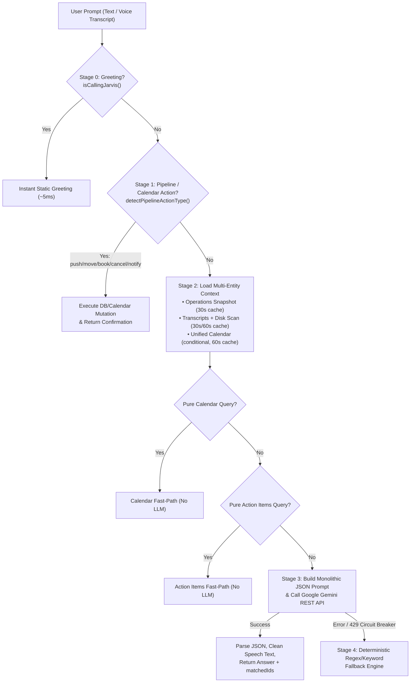

# GapAnchor Ops Dashboard – AI Agent Technical Access & Performance Audit

> **Audit Scope**: Read-only technical investigation of the J.A.R.V.I.S. / AI Agent architecture, permissions, data retrieval pipeline, external integrations, and latency bottlenecks. No code or configuration was modified.

---

## 1. AI Agent Access Inventory (Data & Capabilities)

The AI agent's core backend lives in [`app/api/enquiries/ask-ai/route.ts`](../app/api/enquiries/ask-ai/route.ts) and [`lib/jarvis-pipeline-controller.ts`](../lib/jarvis-pipeline-controller.ts). It has **read and write access** across almost every operational module:

| Module / Data Source | Access Type | Retrieval Mechanism & Scope | Source File |
| :--- | :--- | :--- | :--- |
| **CRM Enquiries (`Enquiry`)** | Read & Write | Raw SQL fetches latest **600 enquiries** (`participantName`, `phone`, `email`, `country`, `course`, `processedNotes`, `lastMessage`, `callScore`, `callFollowUpDate`, `hasRedFlag`, etc.). Can mutate `status` & `contactStatus`. | [`lib/jarvis-pipeline-controller.ts`](../lib/jarvis-pipeline-controller.ts#L540-L644) |
| **Call Intelligence (`LeadCall`)** | Read | Fetches **all** `LeadCall` records (`summary`, `verbatimQuotes`, `budget`, `timeline`, `objections`, `nextAction`, `customerExperience` checklist tables). | [`lib/transcript-knowledge-engine.ts`](../lib/transcript-knowledge-engine.ts#L84-L101) |
| **Local OneDrive / Disk Files** | Read (FS) | Scans 5 Windows/OneDrive folders (`Client Trascripts`, `Recordings`, `Downloads`, `Meetings`) and parses `.docx`, `.vtt`, and `.txt` files directly from disk. | [`lib/transcript-knowledge-engine.ts`](../lib/transcript-knowledge-engine.ts#L145-L241) |
| **Training Batches (`Session`)** | Read | Latest **15** `Session` rows including all `SessionParticipant` rows (trainer fees, paid/due amounts, trainee payment status). | [`lib/jarvis-pipeline-controller.ts`](../lib/jarvis-pipeline-controller.ts#L660-L664) |
| **Finance Ledger (`Transaction`)** | Read | Fetches **all** `Transaction` rows to compute total income, total expenses, net revenue, and latest incoming payment. | [`lib/jarvis-pipeline-controller.ts`](../lib/jarvis-pipeline-controller.ts#L665-L667) |
| **Trainer Applicants (`TrainerRegistration`)** | Read | Latest **15** trainer/work-with-us registrations (`name`, `email`, `phone`, `experienceYears`, `notes`). | [`lib/jarvis-pipeline-controller.ts`](../lib/jarvis-pipeline-controller.ts#L668-L671) |
| **Calendars (MS Graph + Google)** | Read & Write | Reads Microsoft Graph `/me/calendarView` (`contact@gapanchor.com`) + Google Calendar/iCal (`xavierarul40@gmail.com`). Can **book and cancel** Microsoft Calendar meetings with Teams links. | [`lib/microsoft-calendar.ts`](../lib/microsoft-calendar.ts#L213-L250) |
| **Action Items (`LeadCall` + `Enquiry`)** | Read | Parses structured markdown/TSV checklists inside `customerExperience` and `processedNotes`. | [`lib/action-items.ts`](../lib/action-items.ts#L108-L120) |
| **Push Notifications & Config** | Write | Can dispatch consolidated mobile push alerts via **NTFY** (`sendNtfyPipelineDueAlert`), write pipeline timestamps to `IntegrationConfig`, and overwrite `GEMINI_API_KEY` in `.env` via `/api/ai/config`. | [`lib/jarvis-pipeline-controller.ts`](../lib/jarvis-pipeline-controller.ts#L931-L950) |

---

## 2. Permissions, Auth & Security Restrictions

> **Critical Security & Isolation Gap Found**: While `/api/enquiries/sync-excel` and page routes in [`middleware.ts`](../middleware.ts#L35-L38) enforce RBAC and demo masking, **the AI endpoint does not**.

1. **No Session Check on `/api/enquiries/ask-ai`**:
   - [`middleware.ts`](../middleware.ts#L36-L38) passes all `/api/*` requests (except `/api/admin/*`) directly to the route handlers.
   - [`app/api/enquiries/ask-ai/route.ts`](../app/api/enquiries/ask-ai/route.ts#L421) **never reads the `gapanchor_session` cookie**. Any unauthenticated request to `POST /api/enquiries/ask-ai` can query CRM/financial data or trigger calendar bookings and pipeline updates.
2. **No Employee Scoping (`assignedToId`)**:
   - Because `FollowUpAssistantBar` is rendered on `/enquiries`, logged-in employees (`employee.a/b/c@gapanchor.com`) can ask J.A.R.V.I.S. questions and access **all 600 leads**, company-wide revenue/expenses, trainer payouts, and private call transcripts—bypassing the employee assignment filter enforced in `sync-excel`.
3. **No Demo Data Masking (`isDemoSession`)**:
   - Unlike `sync-excel` and `call-intelligence`, `ask-ai` never calls `isDemoSession()` or `maskEnquiriesForDemo()`. A `demo@gapanchor.com` user asking J.A.R.V.I.S. receives **live, unmasked customer names, phone numbers, emails, and real financial figures**.
4. **Shared Global Multi-Turn State**:
   - Frontend callers (`FollowUpAssistantBar.tsx` and `JarvisHolographicHud.tsx`) do not pass a user-specific `sessionId` to `/api/enquiries/ask-ai`. Consequently, `activeSubjectBySession`, `activeTopicBySession`, and `pendingBookingsBySession` in `lib/jarvis-pipeline-controller.ts` all write to the shared `'global'` key—meaning concurrent users can overwrite each other's conversational memory.
5. **Hardcoded Fallback Key**:
   - [`lib/gemini-client.ts`](../lib/gemini-client.ts#L12) embeds a `HARDCODED_GEMINI_KEY` fallback in source code.

---

## 3. How Information Is Retrieved (4-Stage Request Pipeline)

When a user sends a text or voice prompt to `POST /api/enquiries/ask-ai`, it routes through four stages:

---

## 4. How It Searches, Processes & Understands CRM Data

The agent does **not** use SQL `WHERE` search, full-text indexing, or vector embeddings (`pgvector`). Instead, it uses **full-snapshot in-memory JavaScript filtering**:

1. **Full-Table Pull**: On cache miss, `getComprehensiveLeadContext` pulls the latest **600 `Enquiry` rows** and **all `LeadCall` rows**, merging them in Node.js memory by `enquiryId` and lowercase `participantName`.
2. **Deterministic Intent Scanners (`detectAndEvaluateFullDatabaseFilter`)**: Regexes check for specific filter intents (`transcripts`, `with notes`, `due/overdue`, `country` keywords, `course` keywords) and return exact matching lead IDs so the UI table updates synchronously.
3. **Keyword-Scored Retrieval for LLM Context**: To select up to **15 `matchedProspects`** for the Gemini prompt, `ask-ai/route.ts` (lines 682–718) tokenizes the prompt (dropping stopwords) and scores every lead in memory:
   - Exact prompt substring in `notes` (`+10`), `name` (`+10`), `lastMessage` (`+8`)
   - Token hits in `name`/`leadCode` (`+5`), `notes`/`phone` (`+4`), `lastMessage`/`email`/`transcriptSummary` (`+3`), `course`/`country` (`+2`).
4. **Speech Post-Processing**: Before returning, `cleanOutput()` strips internal lead codes (`GAMA-0001`), replaces hyphens/dashes with spaces or commas, converts currency (`₹6,57,062`) into Indian spoken words (`6 lakh 57 thousand 62 rupees`), and enforces `"boss"` salutations.

---

## 5. AI Models, APIs, Tools & Backend Services Used

| Component | Technology / Service | Details Observed in Code |
| :--- | :--- | :--- |
| **LLM & Multimodal STT** | **Google Gemini REST API** (`v1beta`) | Model cascade in [`lib/gemini-client.ts`](../lib/gemini-client.ts#L57-L63): `gemini-3.1-flash-lite` ➔ `gemini-3.5-flash` ➔ `gemini-flash-latest`. Includes a 5-minute 429 circuit breaker. |
| **Browser Voice Input (STT)** | **Web Speech API + MediaRecorder Fallback** | [`lib/jarvis-listener.ts`](../lib/jarvis-listener.ts) runs continuous wake-word detection (`SpeechRecognition`) and falls back to `MediaRecorder` ➔ `POST /api/ai/transcribe` (base64 audio sent to Gemini). |
| **Neural Voice Output (TTS)** | **Microsoft Edge TTS (`msedge-tts`)** | [`app/api/ai/speak/route.ts`](../app/api/ai/speak/route.ts) synthesizes audio exclusively with `en-US-BrianMultilingualNeural` (and curated male profiles), with a 250-entry server LRU cache and staggered client chunk buffering ([`lib/jarvis-speech.ts`](../lib/jarvis-speech.ts)). |
| **Database** | **Supabase PostgreSQL + Prisma** | `prisma.$queryRawUnsafe` and standard Prisma queries. |
| **External Integrations** | **Microsoft Graph, Google Calendar, NTFY** | Live calendar sync/booking + push notifications. |
| **UI Callers** | 3 Frontend Entry Points | `FollowUpAssistantBar.tsx` (`/enquiries`), `JarvisHolographicHud.tsx` (`/jarvis`), `DailyPipelineBoard.tsx`. |

---

## 6. Root Causes: Why Responses Take 5–10+ Seconds

Even on straightforward queries, several sequential bottlenecks stack together:

### 1. Oversized Monolithic JSON Prompt (~2,500–8,000+ Tokens Per Request)
In [`ask-ai/route.ts`](../app/api/enquiries/ask-ai/route.ts#L794-L848), **every** Gemini request pretty-prints (`JSON.stringify(..., null, 2)`) up to **10 separate data blocks**:
- Latest 10 enquiries + 15 matched prospects + 18 leads with call notes + 15 evaluated candidates + 6 sessions with participants + all calendar events + 6 financial transactions + full breakdowns + full DB match list + action items.
- Pretty-printing indentation adds ~25–30% wasted whitespace tokens, and `callGemini` waits for the **entire** non-streaming JSON payload (`maxOutputTokens: 2048`) before returning (**~2.5s–5.0s**).

### 2. Sequential Request Waterfall (LLM ➔ TTS Chunk 0)
In [`FollowUpAssistantBar.tsx`](../components/call-intelligence/FollowUpAssistantBar.tsx#L438-L493):
1. UI awaits the full `/api/enquiries/ask-ai` JSON response.
2. **Only after** the full answer arrives does it call `await speakJarvis(fullSpeech)`, which triggers a **second** network call to `/api/ai/speak` (WebSocket round-trip to Microsoft Edge TTS).
3. UI intentionally stays in the `'thinking'` state until Chunk 0 audio is decoded and starts playing (`onStart`).
- **Result**: User waits for `Ask-AI Latency (3–6s) + Edge-TTS Latency (1–2.5s) = 4–8.5s` before seeing or hearing anything.

### 3. Expensive Cache-Miss Storms (Every 30 Seconds + Serverless Cold Starts)
- `CACHE_TTL_MS` in `ask-ai/route.ts` is only **30 seconds**.
- Every cache miss pulls 600 enquiries + all `LeadCall` + all `Transaction` + `Session` + `TrainerRegistration` from remote Supabase **AND** calls `getTranscriptKnowledgeSnapshot()`, which runs **synchronous filesystem scans (`fs.readdirSync`, `fs.statSync`, `fs.readFileSync`, `extractTextFromDocx`)** across 5 Windows/OneDrive folders. Reading synced/cloud OneDrive `.docx` files on demand can stall the event loop for **1–4+ seconds**.

### 4. False-Positive Calendar Fetches (2s–8s Delay)
- Line 484 sets `needsCalendar = true` if the prompt contains `"demo"`, `"batch"`, `"session"`, `"today"`, `"tomorrow"`, or `"week"`.
- A pure CRM question like *"Who asked for a demo today?"* unnecessarily triggers `getUnifiedCalendarEvents()`, which races Google Calendar (up to **6s** timeout) and Microsoft Graph (up to **2s** timeout + potential OAuth token refresh HTTP call & DB write).

### 5. Sequential Model Retry Loop Without Request Timeouts
- [`lib/gemini-client.ts`](../lib/gemini-client.ts#L67-L112) iterates sequentially across up to 4–5 model names (`gemini-3.1-flash-lite`, `gemini-3.5-flash`, `gemini-flash-latest`, etc.) without an `AbortController` timeout on `fetch`. If a model endpoint stalls or returns a non-429 error, retries compound into **10–15+ seconds**.

### 6. Audio Upload Fallback Overhead (Voice Mode)
- When `MediaRecorder` fallback triggers instead of native `SpeechRecognition`, audio is base64-encoded and sent to `/api/ai/transcribe` (a separate Gemini multimodal call taking **1.5s–3s**) *before* `/api/enquiries/ask-ai` starts.

---

## 7. Architectural Improvements for 1–2 Second Responses

To bring straightforward queries down to **1–2 seconds** (while fixing the permission gaps):

| Optimization | Impact | Technical Approach |
| :--- | :--- | :--- |
| **1. Intent-Scoped Minimal Context** | **-1.5s to -3.5s** | Stop sending all 10 JSON tables on every request. Send **only** the slice needed (e.g., finance aggregates only for finance queries; 1–3 candidate profiles for candidate lookups). Remove `null, 2` pretty-printing from `JSON.stringify`. |
| **2. Stream Gemini + Pipelined TTS** | **-1.5s to -2.5s perceived** | Switch `callGemini` to Gemini SSE streaming (`:streamGenerateContent?alt=sse`). Display text tokens immediately and dispatch Chunk 0 to `/api/ai/speak` as soon as the **first sentence** finishes (~500ms) while the rest of the answer is still generating. |
| **3. Expand Zero-LLM Fast-Paths** | **< 400ms total** | Calendar and Action Items fast-paths already prove this works. Add deterministic fast-paths for: **Latest N leads**, **Course/Country counts**, **Finance summary**, and **Single-candidate contact/notes lookup**. |
| **4. Remove Disk Scanning from Live Queries** | **-1s to -3s on cold cache** | Move OneDrive `.docx`/`.vtt` folder scanning out of `ask-ai` into an explicit background sync or cron job. Live queries should read strictly from indexed PostgreSQL tables, with event-based cache invalidation instead of a 30s TTL. |
| **5. Background Calendar SWR & Tighter Triggers** | **-1s to -6s** | Exclude lead-intent queries (e.g. *"who asked for a demo"*) from triggering `needsCalendar`. Serve cached calendar events immediately and refresh in the background (stale-while-revalidate). |
| **6. Strict Fetch Timeouts (`AbortController`)** | **Eliminates 10s+ hangs** | Add a `3500ms` timeout per Gemini `fetch` call and limit candidate retries so degraded API states drop smoothly to the local deterministic engine in < 4s. |
| **7. Enforce Auth, RBAC & Session Scoping** | **Critical Security Fix** | Validate `gapanchor_session` in `/api/enquiries/ask-ai`, filter `Enquiry` context by `assignedToId` for employees, apply `maskEnquiriesForDemo()` for demo users, and key multi-turn memory maps by authenticated `user.id`. |
