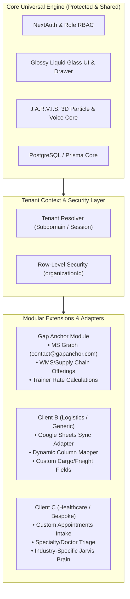
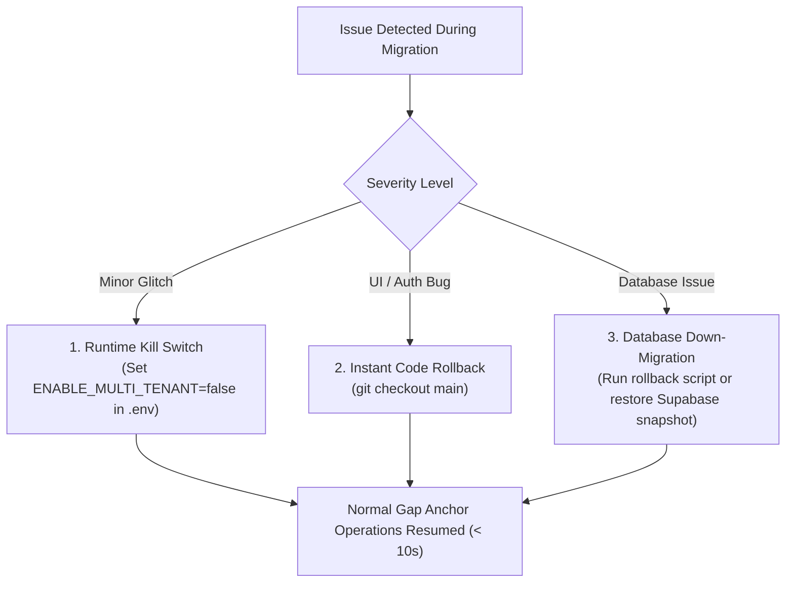

# 🚀 Commercialization & Client Customization Master Plan

## Executive Overview

This document defines the step-by-step architectural strategy to evolve the **Gap Anchor Ops Dashboard** into a commercial, multi-client, industry-adaptable operations platform. It ensures:
1. **Zero downtime & zero regression** for current Gap Anchor live operations (Tenant Zero).
2. **Support for custom client requests** (Google Sheets lead intake, custom industry fields, tailored workflows).
3. **One unified, maintainable codebase** utilizing the **Core Engine + Modular Extensions** design pattern.
4. **Strict protection** of locked modules: Microsoft Graph sync, J.A.R.V.I.S. Living Particle Sphere, voice engine, and drawer components.

---

## Architecture Flow



---

## Phased Implementation Plan

### Phase 1: Database Schema Evolution (Non-Destructive)
- **Goal:** Enable multi-tenancy without touching or renaming existing production columns.
- **Actions:**
  1. Add `Organization` model in `prisma/schema.prisma` with fields:
     - `id`, `name`, `slug`, `logoUrl`, `primaryColor`, `currency`, `offerings` (`String[]`), `createdAt`.
  2. Add nullable `organizationId` foreign key to `User`, `Enquiry`, `Transaction`, `Session`, `IntegrationConfig`.
  3. Add `customFields Json?` column to `Enquiry` to accommodate arbitrary client fields (e.g. Google Sheets columns).
  4. Create and run a safe data migration script that:
     - Inserts `Organization` record with `id: "gap-anchor"`, `name: "Gap Anchor"`, `slug: "gap-anchor"`.
     - Automatically backfills `organizationId = "gap-anchor"` for all 398+ existing enquiries, transactions, and sessions.
- **Safety Guarantee:** No columns deleted, no breaking changes. Live queries without `organizationId` continue to function.

---

### Phase 2: Tenant Context & Auth Scoping
- **Goal:** Ensure each user only sees and modifies data belonging to their organization.
- **Actions:**
  1. Extend NextAuth session callback in `app/api/auth/[...nextauth]/route.ts`:
     - Attach `organizationId`, `organizationSlug`, and `role` (`SUPER_ADMIN`, `TENANT_ADMIN`, `EMPLOYEE`).
     - Set default fallback to `"gap-anchor"` for existing accounts.
  2. Build a lightweight tenant helper (`lib/tenant-context.ts`):
     - `getTenantContext(req)` extracts organization ID from session or API key.
  3. Wrap API endpoints with tenant filtering:
     ```ts
     const enquiries = await prisma.enquiry.findMany({
       where: { organizationId: tenant.id }
     });
     ```
- **Safety Guarantee:** Gap Anchor users automatically resolve to the Gap Anchor organization and see their exact data.

---

### Phase 3: The Custom Data Engine (Google Sheets & Dynamic Fields)
- **Goal:** Allow new clients to connect Google Sheets with custom columns and map them dynamically.
- **Actions:**
  1. **Google Sheets Sync Engine** (`lib/adapters/google-sheets.ts`):
     - Service account / API key reader that fetches rows from a client's Google Sheet URL.
  2. **Visual Column Mapping Interface**:
     - System inspects Sheet header row (e.g., `[Client Name, Phone, Cargo, City, Budget]`).
     - Admin maps primary fields (`Client Name` ➔ `fullName`, `Phone` ➔ `phone`).
     - Unmapped headers are automatically saved in `customFields: { "cargo": "...", "city": "...", "budget": "..." }`.
  3. **Dynamic CRM Table Extension**:
     - Update the enquiries table view to read keys from `customFields` and render corresponding columns dynamically for that client.
- **Safety Guarantee:** Gap Anchor continues using Microsoft Graph sync (`lib/outlook-graph-sync.ts`) without any changes.

---

### Phase 4: Configurable Branding & Offerings
- **Goal:** Replace hardcoded domain names with dynamic client configurations.
- **Actions:**
  1. **Offerings / Products Config**:
     - Allow admins to edit offerings in Settings.
     - Gap Anchor: *Manhattan WMS, Blue Yonder, Kinaxis, SAP S/4HANA*.
     - Client B: *Air Freight, Ocean Shipping, Warehousing*.
  2. **Branding Injection**:
     - Inject client logo and brand theme color into `components/DashboardHeader.tsx` and drawer via context.
  3. **Dynamic J.A.R.V.I.S. Persona**:
     - Keep the living particle sphere and neural voice engine untouched.
     - Dynamically inject the organization's business summary and offerings into the system prompt.

---

### Phase 5: Super Admin Console
- **Goal:** Provide a central control room for you to oversee all client workspaces.
- **Actions:**
  1. Build `/superadmin/workspaces` route (restricted to your Super Admin account).
  2. Features:
     - List all client organizations, user counts, and active lead volumes.
     - "Create New Client Workspace" wizard.
     - "Impersonate / Preview Workspace" button for rapid troubleshooting and client support.

---

### Phase 6: Staging Verification & Zero-Downtime Rollout
- **Goal:** Prove complete reliability before updating the live production deployment.
- **Test Checklist:**
  - [ ] Gap Anchor data integrity: Verify all 398+ enquiries, lead calls, and audits match production.
  - [ ] Outlook Sync: Trigger `Sync Outlook` and verify new incoming emails sync to Gap Anchor.
  - [ ] J.A.R.V.I.S. Voice & Particle Sphere: Confirm wake-word and voice responses function normally.
  - [ ] Test Client Onboarding: Create a demo client, connect a test Google Sheet, and verify data isolation.
  - [ ] Cross-tenant leak check: Confirm test client cannot view or access Gap Anchor records.

---

## 🛡️ Rollback & Disaster Recovery Plan

If anything behaves unexpectedly during development, testing, or deployment, the rollback process guarantees recovery in under **2 minutes** with **zero data loss**.



### 1. Code-Level Rollback (Recovery Time: < 30 seconds)
- **Git Safety Pin:** Before writing a single line of code, we create a release tag on `main`:
  ```bash
  git tag -a v1.0.0-gapanchor-stable -m "Stable single-tenant Gap Anchor state"
  ```
- **Branch Isolation:** All work takes place on `feature/multi-tenant-engine`. The `main` branch remains untouched.
- **Rollback Action:** If we need to abort at any point:
  ```bash
  git checkout main
  ```
  Your server immediately serves the exact code running today.

### 2. Database Safety: The "Expand-and-Contract" Pattern
- **Why it is safe:** We follow the enterprise *Expand-and-Contract* pattern:
  - New columns (`organizationId`, `customFields`) are **strictly nullable** (`String?`, `Json?`).
  - No existing columns (`leadCode`, `serviceType`, `trainerTotalCost`) are dropped, renamed, or modified.
  - **Backward Compatibility Guarantee:** Even after the database schema is updated, the **old single-tenant code on `main` can still query and write to the database without a single error**, because it simply ignores the new optional columns.
- **Pre-Migration Snapshot:**
  - An export script will dump all current tables (`Enquiry`, `Transaction`, `Session`, `User`) to a timestamped JSON/SQL backup file locally and via Supabase.
- **Database Down-Migration Script (`prisma/rollback.sql`):**
  - If we want to completely undo the database additions:
    ```sql
    ALTER TABLE "Enquiry" DROP COLUMN IF EXISTS "organizationId", DROP COLUMN IF EXISTS "customFields";
    ALTER TABLE "Transaction" DROP COLUMN IF EXISTS "organizationId";
    ALTER TABLE "Session" DROP COLUMN IF EXISTS "organizationId";
    ALTER TABLE "User" DROP COLUMN IF EXISTS "organizationId";
    DROP TABLE IF EXISTS "Organization";
    ```

### 3. Runtime Emergency Kill Switch (Recovery Time: < 10 seconds)
- A single environment variable in `.env`:
  ```env
  ENABLE_MULTI_TENANT=false
  ```
- If set to `false`, all tenant filters, organization routers, and custom field logic are instantly bypassed, reverting the application into pure single-tenant Gap Anchor mode.
