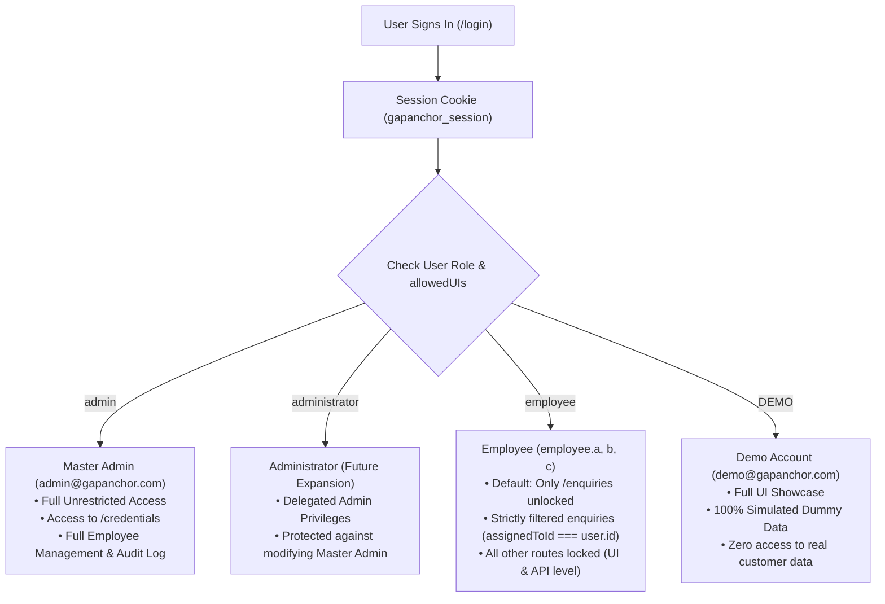

# 🔐 Granular User Access Control & Credentials Management Master Plan

## 1. Executive Summary & Objective

This plan details the implementation of a complete, production-ready **Role-Based Access Control (RBAC)** and **Credentials Management** system for the GapAnchor Ops Dashboard.

The objective is to grant the **Master Admin** centralized control over employee accounts, UI permissions, credentials, account status, and data visibility without disrupting existing application functionality.

---

## 2. Technical Feasibility Analysis: HIGH (100% Feasible)

1. **Centralized Authentication**: `app/api/auth/login/route.ts` already manages credentials and issues the HTTP-only cookie `gapanchor_session`.
2. **Dedicated Middleware**: `middleware.ts` already intercepts all application routes and can inspect session headers and route permissions seamlessly.
3. **Relational Data Model**: The `User` model in `prisma/schema.prisma` is already related to `Enquiry` via `assignedToId` / `assignedTo` relation (`fields: [assignedToId], references: [id]`).
4. **Isolated Demo Mode**: `app/api/auth/login/route.ts` already isolates `demo@gapanchor.com` in memory with zero database footprint.
5. **Zero Regression for Protected Systems**:
   - `lib/outlook-graph-sync.ts` (Microsoft Graph Azure sync) remains 100% untouched.
   - `lib/jarvis-speech.ts` & `components/jarvis/JarvisParticleSphere.tsx` (J.A.R.V.I.S. voice engine) remain 100% untouched.

---

## 3. User Roles & Access Hierarchy



---

## 4. Phased Implementation Architecture

### Phase 1: Database Schema Enhancement (Additive & Non-Breaking)
```prisma
model User {
  id                String    @id @default(cuid())
  name              String
  email             String    @unique
  password          String
  role              String    @default("employee") // "admin" | "administrator" | "employee"
  isActive          Boolean   @default(true)        // Instant account disable toggle
  assignedCourse    String?                         // "Manhattan WMS" | "Blue Yonder" | "Kinaxis" | "SAP S/4HANA"
  allowedUIs        String[]  @default(["enquiries"]) // e.g. ["enquiries", "calendar"]
  assignedEnquiries Enquiry[] @relation("AssignedEnquiries")
  auditActions      AuditLog[] @relation("AdminActions")
  createdAt         DateTime  @default(now())
  updatedAt         DateTime  @updatedAt

  @@index([role])
  @@index([isActive])
}

model AuditLog {
  id           String   @id @default(cuid())
  actorId      String
  actorEmail   String
  actorName    String
  action       String   // "USER_CREATED" | "USER_DISABLED" | "PASSWORD_RESET" | "PERMISSIONS_UPDATED"
  targetUserId String?
  targetEmail  String?
  details      Json?
  ipAddress    String?
  createdAt    DateTime @default(now())

  actor        User     @relation("AdminActions", fields: [actorId], references: [id], onDelete: Cascade)

  @@index([action])
  @@index([actorId])
  @@index([createdAt])
}
```

### Phase 2: Backend Admin Credentials API (`app/api/admin/users/route.ts`)
- `GET /api/admin/users`: Returns all employee accounts, roles, active status, courses, and allowed UI permissions.
- `PATCH /api/admin/users`: Updates `allowedUIs`, resets passwords, changes assigned course, or toggles `isActive`.
- `POST /api/admin/users`: Allows Master Admin to create new employee accounts directly from the UI.
- **Master Admin Protection Lock**: API rejects any modification, deletion, or deactivation of `admin@gapanchor.com`.

### Phase 3: The "Credentials & Access Control" UI (`app/credentials/page.tsx`)
- Liquid Glass Ops themed administrative console.
- Interactive toggle switches for granular UI permissions:
  - `Enquiries CRM` (Always ON)
  - `GapAnchor Calendar` (Toggle ON / OFF)
  - `Training Operations` (Toggle ON / OFF)
  - `Finance Intelligence` (Toggle ON / OFF)
  - `Ops Analytics` (Toggle ON / OFF)
  - `Job Support` (Toggle ON / OFF)
- Quick Password Reset with reveal toggle.
- Enable / Disable account toggle.
- Activity Audit Trail table.

### Phase 4: Route Guards & Navigation Drawer
- `middleware.ts`: Blocks unauthorized direct URL navigation, redirecting to `/enquiries` with an informative banner.
- `components/NavigationDrawer.tsx`: Shows subtle lock badges (`🔒 Locked by Admin`) on restricted views for employees; adds **Credentials** item for Master Admin.
- Enquiry Data Isolation: `app/api/enquiries/route.ts` enforces `where: { assignedToId: sessionUser.id }` for employee roles.

---

## 5. Risk Assessment & Mitigation

| Risk Scenario | Probability | Impact | Mitigation Strategy |
| :--- | :---: | :---: | :--- |
| **Accidental Lockout of Master Admin** | Low | Critical | **Hardcoded Immutable In-Code Safeguard**: `admin@gapanchor.com` always possesses `["*"]` permissions regardless of DB state. Cannot be modified or deleted via API. |
| **Direct URL Navigation Bypass** | Medium | High | **2-Tier Guard**: Enforced at Next.js `middleware.ts` level (redirects URL attempts) and backend API layer. |
| **API Payload Tampering** | Low | High | **Zero Trust API**: APIs never trust client payloads for user ID. All queries read the verified session cookie `gapanchor_session`. |
| **Database Data Loss** | Low | Critical | **Additive Schema Only**: Only new columns (`allowedUIs`, `isActive`) with default values are introduced. Existing data remains 100% intact. |

---

## 6. 3-Tier Rollback & Disaster Recovery Plan (< 2 Minutes SLA)

1. **Level 1: Runtime Kill Switch (< 10 seconds)**:
   - Setting `ENABLE_RBAC=false` in `.env` immediately bypasses all permission checks and restores baseline open access.
2. **Level 2: Code Rollback (< 30 seconds)**:
   - Tag pinned prior to development: `git tag -a v1.1.0-pre-rbac -m "Pre-RBAC stable state"`.
   - Rollback command: `git checkout v1.1.0-pre-rbac`.
3. **Level 3: Database Down-Migration (< 90 seconds)**:
   - Script `prisma/rollback_rbac.sql`:
     ```sql
     ALTER TABLE "User" DROP COLUMN IF EXISTS "allowedUIs", DROP COLUMN IF EXISTS "isActive";
     DROP TABLE IF EXISTS "AuditLog";
     ```
