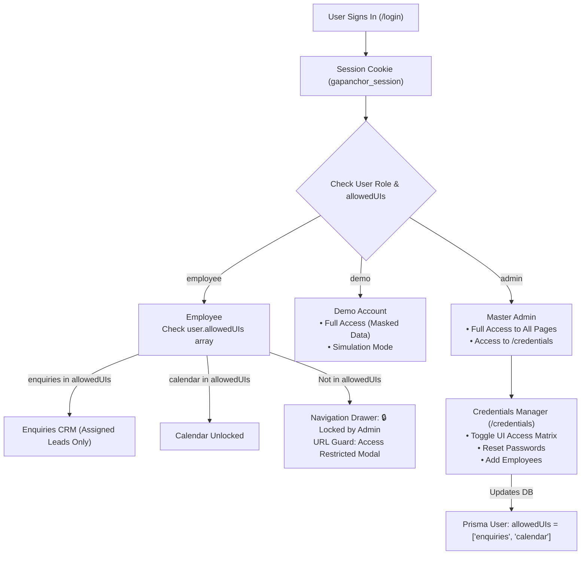

# 🔐 Granular User Access Control & Credentials Management Master Plan

## Overview & Objectives

This plan details the implementation of a full-fledged **Role-Based Access Control (RBAC)** and **Credentials Management** system for the Gap Anchor Ops Dashboard. 

### Core Goals:
1. **Master Admin (`admin@gapanchor.com`)**: Full unrestricted access, new "Credentials" navigation item, and ability to toggle UI permissions and reset credentials for employees.
2. **Demo Showcase (`demo@gapanchor.com`)**: Complete UI showcase access using masked/simulated dummy data; zero access to real customer emails or leads.
3. **Employees (`employee.a`, `employee.b`, `employee.c`)**:
   - Access restricted to the **Enquiry Intelligence** (`/enquiries`) page by default.
   - Strictly see only leads assigned to them (`assignedToId === user.id`).
   - All other navigation views (Calendar, Finance, Training Ops, Ops Analytics, etc.) display as **`🔒 Locked by Administrator`**.
   - Master Admin can grant access to specific UIs (e.g. Calendar) via the Credentials manager.
4. **Zero Regression Guarantee**: Keep Microsoft Graph sync, live enquiries, and J.A.R.V.I.S. neural voice engine 100% protected.

---

## Architecture & Data Flow



---

## Detailed Implementation Phases

### Phase 1: Database Schema Enhancement (Additive & Non-Breaking)
- **Goal:** Store permitted UI sections per user in PostgreSQL.
- **Actions:**
  1. Update `prisma/schema.prisma` `User` model:
     ```prisma
     model User {
       id                String    @id @default(cuid())
       name              String
       email             String    @unique
       password          String
       role              String    @default("employee") // "admin" | "employee"
       assignedCourse    String?   // "Manhattan WMS" | "Blue Yonder" | "Kinaxis" | "SAP S/4HANA"
       allowedUIs        String[]  @default(["enquiries"]) // NEW: e.g. ["enquiries", "calendar"]
       assignedEnquiries Enquiry[] @relation("AssignedEnquiries")
       createdAt         DateTime  @default(now())
       updatedAt         DateTime  @updatedAt
     }
     ```
  2. Run `npx prisma db push` to synchronize the schema without dropping data.
  3. Update `scripts/seed_employees.js` to initialize default permissions:
     - Master Admin: `allowedUIs: ["*"]` (or all section IDs).
     - Employees A, B, C: `allowedUIs: ["enquiries"]`.
     - Execute an idempotent backfill script to update existing database users.

---

### Phase 2: Backend Admin Credentials API (`app/api/admin/users/route.ts`)
- **Goal:** Provide secure endpoints for the Master Admin to manage credentials and permissions.
- **Endpoints:**
  1. `GET /api/admin/users`:
     - Verifies session is authenticated and `sessionUser.role === 'admin'`.
     - Returns list of all employee users: `id`, `name`, `email`, `role`, `assignedCourse`, `allowedUIs`, `updatedAt`.
  2. `PATCH /api/admin/users`:
     - Allows updating:
       - `allowedUIs`: `string[]` (e.g. `["enquiries", "calendar"]`).
       - `password`: Optional new password string.
       - `assignedCourse`: Assigned platform/specialty.
  3. `POST /api/admin/users`:
     - Allows Master Admin to create a new employee directly from the UI without database scripts.

---

### Phase 3: The "Credentials & Access Control" UI (`app/credentials/page.tsx`)
- **Goal:** Create a polished, Liquid Glass Ops themed administrative interface.
- **Components:**
  1. **Header & Stats Banner**:
     - Total Employees, Active Logins, Admin Accounts count.
     - "+ Add New Employee" modal trigger.
  2. **Employee Access Cards / Table**:
     - Shows each employee's details (Name, Email, Assigned Course, Role).
     - **UI Permission Matrix (Toggle Switches)**:
       - `Enquiries CRM` ➔ Locked ON (Core capability).
       - `GapAnchor Calendar` ➔ Switch (ON / OFF).
       - `Training Operations` ➔ Switch (ON / OFF).
       - `Finance Intelligence` ➔ Switch (ON / OFF).
       - `Ops Peak Analytics` ➔ Switch (ON / OFF).
       - `Job Support Operations` ➔ Switch (ON / OFF).
       - `Dev Progress & Infra` ➔ Switch (ON / OFF).
       - `API & Setup` ➔ Switch (ON / OFF).
  3. **Password Management & Reset**:
     - Quick "Reset Password" input with reveal/hide toggle and instant save.

---

### Phase 4: Navigation Drawer & Route Guard Protection
- **Goal:** Visual lock states in the drawer and URL protection for direct access attempts.
- **Components & Seams:**
  1. **Permission Helper (`lib/permissions.ts`)**:
     - Defines available UI sections and IDs matching `NavigationDrawer.tsx`.
     - Helper function `canAccessUI(user, sectionId): boolean`.
  2. **Navigation Drawer Update (`components/NavigationDrawer.tsx`)**:
     - *Note: Protected file. Will be updated with minimal, surgical diff following double-confirmation.*
     - For `role === 'admin'`: Add **"Credentials"** item with Key/Shield icon at the bottom of the drawer.
     - For `role === 'employee'`:
       - If section is in `allowedUIs`: Render as active, normal, clickable.
       - If section is NOT in `allowedUIs`: Render with `opacity-40`, display a `🔒 Locked by Admin` badge, and show a sleek modal/toast if clicked: *"Access restricted by administrator."*
  3. **Route Guard Component (`components/auth/PermissionGate.tsx`)**:
     - Protects pages (e.g., `/calendar`, `/training`, `/finance/analytics`).
     - If an employee tries to access a restricted URL directly, it displays a friendly "Access Locked by Administrator" screen with a "Back to Enquiries" button.

---

### Phase 5: Verification & End-to-End Testing Matrix

| Test Case | Account Used | Expected Outcome |
| :--- | :--- | :--- |
| **Master Admin Full Access** | `admin@gapanchor.com` | Can access all pages + sees "Credentials" in drawer. |
| **Demo Showcase Account** | `demo@gapanchor.com` | Sees full UI with masked data; cannot access real leads or credentials. |
| **Employee Default State** | `employee.a@gapanchor.com` | • Enquiries page loads with only leads assigned to Employee A.<br>• Drawer shows Calendar, Finance, Ops as `🔒 Locked`.<br>• Typing `/calendar` in URL is blocked. |
| **Admin Grants Permission** | `admin@gapanchor.com` | Admin turns `Calendar: ON` for Employee A in `/credentials`. |
| **Employee Real-Time Unlock** | `employee.a@gapanchor.com` | Employee A refreshes drawer ➔ Calendar is now unlocked and accessible. |
| **Password Reset** | `admin@gapanchor.com` | Admin resets password for Employee B ➔ Employee B logs in with new password. |

---

## Safety & Regression Guard

1. **Microsoft Graph & Live Enquiries**:
   - `lib/outlook-graph-sync.ts` and Graph sync endpoints remain 100% untouched.
2. **J.A.R.V.I.S. Living Particle Sphere & Voice Engine**:
   - `lib/jarvis-speech.ts`, `lib/jarvis-listener.ts`, and `JarvisParticleSphere.tsx` remain 100% untouched.
3. **Additive Database Operations**:
   - `allowedUIs` is added with `@default(["enquiries"])`. Existing database records remain valid and intact.
