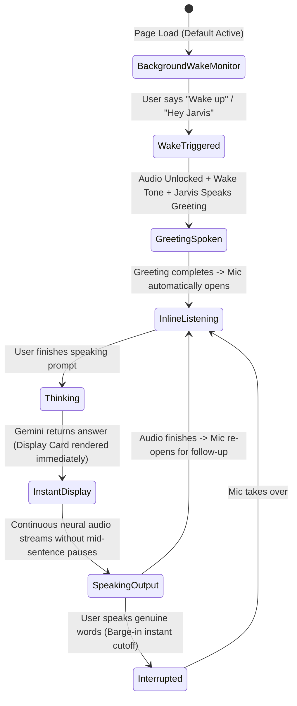

# 🎙️ J.A.R.V.I.S. VOICE ENGINE & WAKE-UP ARCHITECTURE

> **LOCKED CORE PROTOCOL**: This document defines the mission-critical voice architecture for **J.A.R.V.I.S.** across the GapAnchor Ops Platform. Any future modifications to voice capture, speech synthesis, or wake-word recognition MUST conform to this specification and preserve all wake triggers.

---

## 1. Wake-Up Command Specification

J.A.R.V.I.S. supports continuous background listening ("Always-On Wake-Word") and direct UI invocation. The background monitor runs on modern browsers (Desktop Chrome/Edge, Mobile Chrome, and Safari) and detects human conversational wake-up phrases without false positives or silent stalling.

### Supported Wake Phrases & Regex Triggers:
1. **Direct Wake-Up Calls**:
   - `"Wake up"`
   - `"Wake up, Jarvis"`
   - `"Jarvis, wake up"`
   - `"Wake up buddy"`
   - `"Wake up boss"`
   - `"Wake up now"`
   - `"Wake up please"`
   - `"Wake"` / `"Wake Jarvis"`
2. **Standard Salutations**:
   - `"Hey Jarvis"` / `"Hi Jarvis"` / `"Hello Jarvis"` / `"OK Jarvis"` / `"Okay Jarvis"`
   - Pure `"Jarvis"`
3. **Presence Checks**:
   - `"Are you there, Jarvis?"`
   - `"You there?"`
   - `"Can you hear me?"`
   - `"Listen up, Jarvis"`
   - `"Stand by, Jarvis"`

### Core Regex Implementation:
Located in [`lib/jarvis-listener.ts`](file:///c:/Users/ARUL%20XAVIER/OneDrive%20-%20gapanchor/dashboard/lib/jarvis-listener.ts) and [`lib/jarvis-speech.ts`](file:///c:/Users/ARUL%20XAVIER/OneDrive%20-%20gapanchor/dashboard/lib/jarvis-speech.ts):
```typescript
const STRICT_WAKE_WORD_REGEX = /^\s*(?:hey|hi|hello|ok|okay)?[\s,.]*(?:jarvis|javis|jervis|jar\s*vis|travis|service|davis|harvest|starburst)\b/i;
const INLINE_WAKE_WORD_REGEX = /\b(?:hey|hi|hello|ok|okay)[\s,.]+(?:jarvis|javis|jervis|travis|service|davis|harvest|starburst)\b/i;
const PURE_JARVIS_REGEX = /\b(?:jarvis|javis|jervis|jar\s*vis)\b/i;
const WAKE_UP_COMMAND_REGEX = /\b(?:wake\s*up|wake(?:\s*-\s*up)?|wake\s+up\s+jarvis|wake\s+jarvis|jarvis\s+wake\s*up|are\s+you\s+there|you\s+there|can\s+you\s+hear\s+me|listen\s*up|stand\s*by)\b/i;
```

---

## 2. Voice State Machine & Interaction Flow



### Key Behavioral Rules:
1. **Immediate Greeting on Wake-Up**:
   When woken up via `"Wake up"` or `"Hey Jarvis"`, J.A.R.V.I.S. speaks:
   - *Morning*: `"Good morning, boss! Ready and listening—what can I get done for you?"`
   - *Afternoon*: `"Good afternoon, boss! Ready and listening—what can I get done for you?"`
   - *Evening*: `"Online, boss! Ready and listening—what can I get done for you?"`
2. **Zero Speech Pauses**:
   Sentences under 750 characters are synthesized in a single audio buffer. Do **NOT** break sentences into 3-word chunks that create 2–3 second artificial pauses.
3. **Immediate Answer Display**:
   When asking a question, `setAiResponse` MUST be invoked immediately when `data.answer` arrives from `/api/enquiries/ask-ai`. Do NOT gate UI rendering behind the completion of the TTS network fetch.
4. **Intent Isolation**:
   - **Lead Queries**: 100% focused on lead triage, candidate follow-ups, and pipeline actions. Never mention revenue or finance figures.
   - **System Status Queries** (`"How is the system doing?"`): Provides the 3-pillar executive summary (503 Leads overview + Upcoming Calendar events + Short Finance numbers).
5. **Polite Address**:
   J.A.R.V.I.S. must strictly address the user as **"boss"** at all times. Never use "sir", "madam", or generic bot greetings.

---

## 3. Autoplay & AudioContext Unlocking Protocol

Modern browsers restrict `AudioContext` and `HTMLAudioElement.play()` without prior user gestures:
1. **Multi-Gesture Listener**: On page load, `click`, `keydown`, and `touchstart` invoke `unlockJarvisAudio()`.
2. **Wake Tone Fallback**: When background speech recognition fires `onresult`, `unlockJarvisAudio()` is called immediately inside the callback.
3. **Web Audio Decoding**: Pre-decoded `AudioBufferSourceNode` is preferred over `new Audio(url)` for zero-latency, cross-platform reliability on iOS and mobile Chrome.

---

## 4. Protected Files for Jarvis Voice
The following files implement this system and MUST be preserved against regression in future tasks:
- `lib/jarvis-listener.ts` (Speech recognition, MediaRecorder fallback, wake-word monitor)
- `lib/jarvis-speech.ts` (Neural Edge-TTS client, Indian currency sanitization, intent classification)
- `app/api/ai/speak/route.ts` (Edge-TTS neural synthesis streaming backend)
- `components/call-intelligence/FollowUpAssistantBar.tsx` (Inline Voice Bar, state machine, audio controls)
