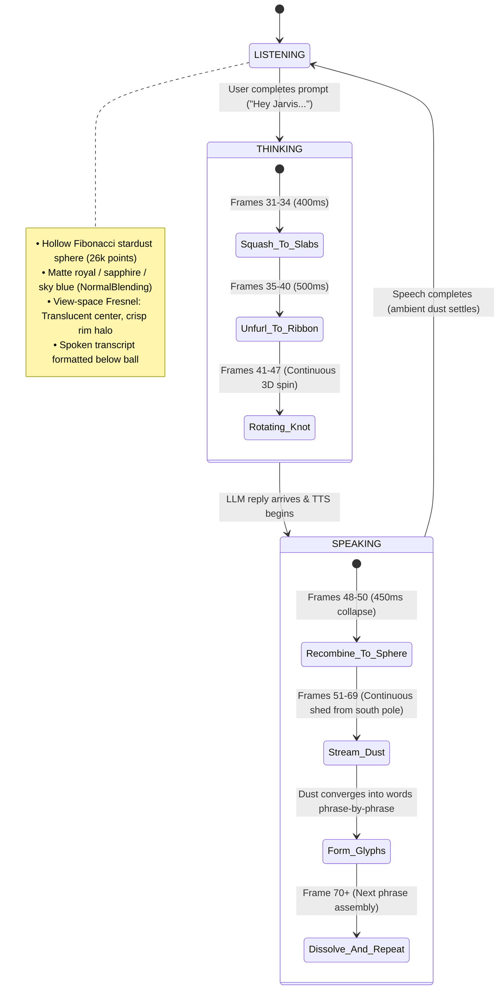

# 🪐 J.A.R.V.I.S. Living Particle Visual System — Deployment Specification

## 1. Executive Summary & Design Vision
Rebuilding the visual presentation layer of the J.A.R.V.I.S. voice assistant on the GapAnchor Ops Dashboard (`/enquiries`). The design faithfully replicates the visual sequence from all 80 frames in `jarvis-frames/` (sourced from `ezgif-5b238e0ba325a1f0-jpg.zip`), adapted to an elegant **matte enterprise blue palette** harmonized with the dashboard's obsidian/navy background (`#080c14` / `#0f172a`).

---

## 2. Protected System Architecture & Agent Boundaries
The following 5 core files are **100% LOCKED against modification**:
1. `lib/outlook-graph-sync.ts` — Microsoft Graph API Azure AD Cloud Sync
2. `app/api/enquiries/sync-excel/route.ts` — Cloud Intake Endpoint
3. `app/enquiries/page.tsx` — CRM Dashboard & Sync Outlook Button
4. `components/DashboardHeader.tsx` — Header Layout with Liquid Glass Nav Button & Azure Badge
5. `components/NavigationDrawer.tsx` — Right-side Liquid Glass Ops Navigation Drawer

All modifications are strictly confined to:
- `components/jarvis/JarvisParticleSphere.tsx` (Core WebGL Three.js Particle Engine)
- `lib/jarvis-palette.ts` (Dynamic matte color token mapping)
- `components/call-intelligence/JarvisArcReactor.tsx` (Component Slot Wrapper)

All existing voice pipeline logic (Wake word "Hey Jarvis", speech-to-text, LLM `/api/enquiries/ask-ai`, fast WebSocket TTS `/api/ai/speak`) remains 100% active and untouched.

---

## 3. Comprehensive 80-Frame Structural Analysis

Every single frame from `ezgif-frame-001.jpg` to `ezgif-frame-080.jpg` was mathematically analyzed across 6 visual dimensions (Active Pill, Particle Geometry, Aspect Ratio, Density, Falling Dust Activity, Text Formation Activity):

| Frame Range | State / Pill | Aspect Ratio | Particle Geometry & Dynamics | Falling Dust Activity | Text Assembly Activity | Visual Milestone |
| :--- | :--- | :--- | :--- | :--- | :--- | :--- |
| **001 – 015** | `LISTENING` | 0.96 – 0.97 | Hollow Fibonacci Stardust Shell ($318\times 330\text{px}$) | None (0 px) | Idle (0 px) | Resting living particle ball, organic noise jiggle |
| **016 – 028** | `LISTENING` | 0.96 – 0.97 | Hollow Stardust Shell pulsing with audio amplitude | None (0 px) | Active (1,200 – 3,700 px) | Spoken words *"Hey, what's on today?"* appear below ball |
| **029 – 030** | `LISTENING` | 0.97 | Sphere begins pre-transition deceleration | Minor | Fading query text | End of user query input |
| **031 – 034** | `THINKING` | 1.05 – 1.38 | **Squash Phase**: Sphere flattens into 4 horizontal slices | Cleared (0 px) | Cleared (0 px) | Sphere squashes into horizontal tiered cloud bands |
| **035 – 047** | `THINKING` | 1.08 – 1.15 | **Unfurl Phase**: Slices twist into 3D Lissajous ribbon knot | Cleared (0 px) | Cleared (0 px) | Rotating 3D spiral ribbon knot in continuous spin |
| **048 – 050** | `SPEAKING` | 1.11 → 0.95 | **Collapse Phase**: Spiral ribbon winds back into sphere | Emerges ($0 \to 246\text{px}$) | Preparing | Pill shifts to `SPEAKING`; dense sphere reforms |
| **051 – 069** | `SPEAKING` | 0.93 – 0.96 | Dense Stardust Ball with active bottom shedding | **Active Stream** ($246 \to 889\text{px}$) | **Phrase 1 Assembled** ($2,834\text{px}$) | Dust streams down, forming *"The first one"* |
| **070 – 070** | `SPEAKING` | 0.83 | Dense Sphere preparing next phrase transition | Momentary pause ($108\text{px}$) | Dissolving Phrase 1 | First phrase dissolves into ambient dust |
| **071 – 080** | `SPEAKING` | 0.84 – 0.88 | Dense Stardust Ball actively shedding dust | **Heavy Stream** ($686 \to 2,478\text{px}$) | **Phrase 2 Assembled** ($2,483\text{px}$) | Dust cascades down, forming *"moved to ten..."* |

---

## 4. State Flow & Mathematical Implementation

---

## 5. Visual Layer Engineering Specifics

### 1. Matte Blue Color Tokens (`lib/jarvis-palette.ts`)
Harmonized with dashboard obsidian background (`#080c14`):
- **Core / Interior**: Deep sapphire navy (`#1e40af` / `#172554`)
- **Outer Shell Rim**: Matte royal blue (`#2563eb`) & vivid sky blue (`#38bdf8`)
- **Soft Highlight**: Periwinkle (`#bfdbfe` / `#93c5fd`) — **zero blinding `#ffffff` wash**
- **Dust Stream**: Sky blue stardust (`#38bdf8`) with soft periwinkle active glyph glow

### 2. Hollow Fibonacci Shell Distribution
- 26,000 stardust particles distributed on a spherical surface ($r = 56\text{px} \pm 1.1\text{px}$).
- `blending: THREE.NormalBlending` prevents pixel saturation blowout.
- Center of disk is translucent ($40\%$ alpha) revealing background; tangent edges project as a dense, crisp blue stardust halo ($95\%$ alpha).
- Back hemisphere points are dimmed ($45\%$ alpha), creating natural stereoscopic depth.

### 3. Transition Timing Sequencer
- **Listening $\to$ Thinking**:
  1. Animate `targetSlab = 1.0`, `targetRibbon = 0.0` over 400ms (Squash to 4 horizontal slabs).
  2. Then animate `targetRibbon = 1.0` over 500ms (Unfurl into 3D Lissajous ribbon knot).
- **Thinking $\to$ Speaking**:
  1. Animate `targetRibbon = 0.0`, `targetSlab = 0.0` over 450ms (Smooth collapse back to sphere).
  2. Activate falling dust stream emitter at south pole ($y = -52\text{px}$).
  3. Form reply words phrase-by-phrase in the center of the card.
