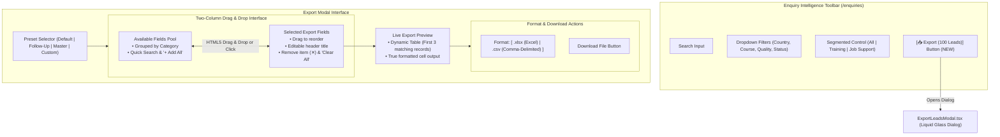
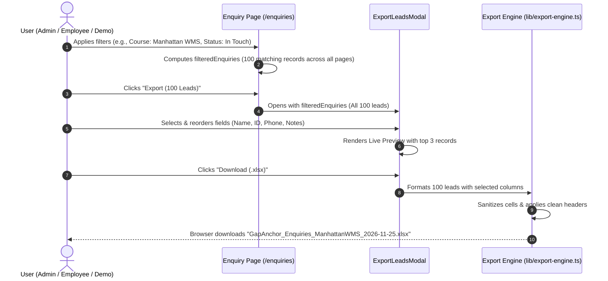

# 📥 Advanced Lead Export with Custom Field Selection — Technical Implementation Plan

## 1. Executive Summary & Objective

This document provides the definitive implementation plan for introducing the **Advanced Lead Export** feature to the Enquiry Intelligence CRM (`/enquiries`).

### Core Objectives:
1. **Unpaginated Full Dataset Export**: Exports **ALL** leads matching currently applied filters and search terms (e.g., all 100 matching leads across all pages), never just the 10 leads on the active page.
2. **Custom Field Selection (Drag & Drop)**: Two-column liquid glass interface allowing users to drag available database fields into selected export columns, reorder them, rename headers, and remove unwanted fields.
3. **Live Export Preview**: Real-time tabular preview of the first 3 rows of actual filtered data reflecting the user's selected fields and column order.
4. **Multi-Format Export**: Support for both Excel (`.xlsx`) and Comma-Separated Values (`.csv`).
5. **Strict Data Isolation**: Full compliance with employee-level lead assignment restrictions (`whereClause.assignedToId`) and demo account synthetic data masking.
6. **Zero Regression Guarantee**: Adherence to protected component boundaries (`app/enquiries/page.tsx` receives minimal surgical integration; all heavy logic is contained in isolated modules).

---

## 2. Current Architecture & Database Audit

### A. Main Files & Component Seams
- **`app/enquiries/page.tsx`**: Contains CRM state, filter dropdowns, and client-side pagination slicing (`paginatedEnquiries = filteredEnquiries.slice(start, start + pageSize)`).
- **`app/api/enquiries/sync-excel/route.ts`**: Existing data endpoint enforcing employee role filtering and demo masking.
- **`lib/demoInterceptor.ts` & `lib/demoDataMasker.ts`**: Enforces demo data protection.
- **Existing Installed Packages**: `xlsx: ^0.18.5`, `papaparse: ^5.4.1`, `lucide-react: ^0.453.0`. No new package installations required.

### B. Complete Available Fields Dictionary (from `prisma/schema.prisma`)
The existing `Enquiry` model contains 27 exportable attributes:

| Field Identifier | Default Header Label | Category | Data Type | Notes / Formatting |
| :--- | :--- | :--- | :--- | :--- |
| `leadCode` | Lead ID / Code | Identity | String | Unique sequential identifier (e.g. `GAMA-0001`) |
| `participantName` | Customer Name | Contact | String | Full candidate / company name |
| `email` | Email Address | Contact | String | Primary email |
| `phone` | Phone Number | Contact | String | Phone / WhatsApp number |
| `country` | Country | Contact | String | Country of origin |
| `serviceType` | Service Type | Course | String | Training vs Job Support |
| `trainingType` | Course / Platform | Course | String | Course title (e.g. Manhattan WMS) |
| `topic` | Specific Topic | Course | String | Subject or module |
| `contactStatus` | Contact Status | Status | String | Pending, In Touch, Talked, Converted, Lost |
| `leadQuality` | Lead Quality | Status | String | High, Medium, Low, Unrated |
| `status` | Operational Status | Status | String | Open, Active, Action Required, Processed |
| `assignedToName` | Assigned Counselor | Ownership | String | Counselor / Employee full name |
| `source` | Lead Source | Ingestion | String | outlook, whatsapp, manual, excel |
| `messageTimestamp` | Enquiry Date | Dates | DateTime | Formatted as `YYYY-MM-DD HH:mm:ss` |
| `dateSubmitted` | Date Submitted | Dates | DateTime | Formatted as `YYYY-MM-DD` |
| `receivedDate` | Received Date | Dates | DateTime | Formatted as `YYYY-MM-DD` |
| `callScore` | Call Score | Intelligence | Number | Volume score (1–10) |
| `callFollowUpDate` | Scheduled Follow-Up | Intelligence | DateTime | Scheduled callback date |
| `hasRedFlag` | Red Flag Alert | Intelligence | Boolean | Formatted as `Yes` / `No` |
| `redFlagReason` | Red Flag Reason | Intelligence | String | Reason extracted by AI |
| `processedNotes` | Operations Notes | Content | String | Counselor notes & remarks |
| `lastMessage` | Last Message | Content | String | Inbound message preview |
| `isStale` | Is Stale | System | Boolean | Formatted as `Yes` / `No` |
| `staleReason` | Stale Reason | System | String | Inactivity reason |
| `processedAt` | Processed At | System | DateTime | Date when marked processed |
| `createdAt` | Record Created | System | DateTime | System entry timestamp |
| `updatedAt` | Last Updated | System | DateTime | Last modified timestamp |

---

## 3. UI/UX Architecture & Placement



### A. Export Button Placement
- **Location**: Right-hand side of the Filters & Search card in `app/enquiries/page.tsx`, directly to the right of the Liquid Glass Segmented Control.
- **Dynamic Badge**: Displays total matching records: `Export (100 Leads)`.
- **Styling**: Cyan-tinted Liquid Glass with frosted backdrop blur, micro-borders, and cyan icon.

### B. Drag-and-Drop Interaction Mechanics
- **Native HTML5 DnD Engine**: Zero bundle bloat; ultra-fast with no hydration conflicts.
- **Available Fields**: Chips grouped by category (Contact, Course, Status, Intelligence, Dates, System).
- **Selected Fields**: Draggable rows equipped with a grip handle (`GripVertical`), column sequence number (`1`, `2`, `3`), inline editable display title, and remove button (`X`).
- **Click-to-Transfer Fallback**: Users can also click `+` on an available field to transfer it immediately, or click `X` to remove it.
- **Reordering**: Dragging chips up or down within the Selected column live-reorders them with a smooth drop indicator.

### C. Live Export Preview
- Renders directly below the field selector.
- Displays the top 3 rows of the user's filtered leads using the exact selected fields and column sequence.
- Shows total export count banner: `Ready to export 100 matching leads across 4 selected columns`.

---

## 4. Technical File Architecture

### A. Files to Create (Isolated & Additive)

1. **`lib/export-engine.ts`**
   - Pure utility functions responsible for data transformation:
     - `generateExcelExport(leads, fields, options)`: Builds workbook using `xlsx.utils.book_new()` and `xlsx.utils.aoa_to_sheet()`. Applies column widths, cell type preservation, and date formatting.
     - `generateCsvExport(leads, fields, options)`: Generates RFC-compliant CSV string using `Papa.unparse()`. Applies CSV formula injection defense (prepends `'` to cells starting with `=`, `+`, `-`, `@`).
     - `triggerBrowserDownload(blob, filename)`: Triggers automatic browser file download.

2. **`components/enquiries/ExportLeadsModal.tsx`**
   - The interactive Liquid Glass modal component:
     - State management for `selectedFields` (order, key, customLabel).
     - Drag-and-drop event handlers (`onDragStart`, `onDragOver`, `onDrop`).
     - Presets manager (`gapanchor_export_presets` in `localStorage`).
     - Live preview table rendering first 3 records.
     - Export execution with loading spinner and Sonner toast alerts.

3. **`app/api/enquiries/export/route.ts`** (Optional Server Pipeline)
   - Independent server endpoint to authenticate sessions, verify employee permissions, apply demo masking, and stream downloads if triggered via API.

### B. Files to Modify (Surgical & Protected)

- **`app/enquiries/page.tsx`**:
  - Add state: `const [exportModalOpen, setExportModalOpen] = useState(false);`
  - Insert Export button adjacent to segmented control (Lines ~920).
  - Mount `<ExportLeadsModal isOpen={exportModalOpen} onClose={() => setExportModalOpen(false)} filteredEnquiries={filteredEnquiries} />`.
  - **No changes to existing filter queries, pagination state, or table logic.**

---

## 5. Security, Permissions & Data Integrity



### A. Employee Access Enforcement
- On page load, `app/api/enquiries/sync-excel/route.ts` already restricts an employee's dataset:
  ```ts
  if (sessionUser.role === 'employee') {
    whereClause.assignedToId = sessionUser.id;
  }
  ```
- An employee's client session only contains leads assigned to them. They can never export leads assigned to other employees or unassigned leads.

### B. Demo Account Privacy Enforcement
- For `demo@gapanchor.com`, data is intercepted by `lib/demoDataMasker.ts`:
  - Names, phone numbers, and emails are synthetically generated.
  - Notes and message texts have emails and phone numbers scrubbed.
- The exported file strictly reflects these masked synthetic values, ensuring zero live customer PII is leaked.

### C. CSV Injection & Formula Defense
- Spreadsheet applications (Excel, LibreOffice) can execute malicious commands if a cell starts with `=`, `+`, `-`, or `@`.
- The export engine sanitizes every text field:
  ```ts
  function sanitizeCell(val: any): any {
    if (typeof val === 'string' && /^[=+\-@]/.test(val)) {
      return `'${val}`;
    }
    return val;
  }
  ```

---

## 6. Export Presets Specification (Section 7)

Users can choose from built-in presets or save their own configurations:
1. **Default Summary** (7 fields):
   `leadCode`, `participantName`, `phone`, `email`, `trainingType`, `contactStatus`, `messageTimestamp`
2. **Counselor & Follow-Up** (8 fields):
   `leadCode`, `participantName`, `phone`, `contactStatus`, `leadQuality`, `callScore`, `callFollowUpDate`, `processedNotes`
3. **Operations & Auditing** (8 fields):
   `leadCode`, `participantName`, `assignedToName`, `source`, `status`, `hasRedFlag`, `redFlagReason`, `updatedAt`
4. **Complete Master Export** (All 27 fields).
5. **Custom Presets**:
   Users can click "Save as Preset", name it (e.g. "Weekly Reporting"), and it will be persisted in `localStorage`.

---

## 7. Step-by-Step Implementation Sequence

| Phase | Tasks | Deliverables | Risk Level |
| :--- | :--- | :--- | :--- |
| **Phase 1** | Export Engine Foundation | Create `lib/export-engine.ts` with XLSX & CSV formatting utilities. | None (Isolated new file) |
| **Phase 2** | Export Modal UI Component | Create `components/enquiries/ExportLeadsModal.tsx` with DnD column picker, presets, live preview, and download triggers. | None (Isolated new file) |
| **Phase 3** | Enquiry Page Integration | Add Export button to filter toolbar in `app/enquiries/page.tsx` and wire modal open state. | Low (Minimal additive change) |
| **Phase 4** | Optional Server Route | Create `app/api/enquiries/export/route.ts` for server-side authorization validation. | None (Isolated new file) |
| **Phase 5** | Multi-Account Verification | Test end-to-end with Admin, Employee A, and Demo accounts across Excel & CSV formats. | Low |

---

## 8. Regression Testing & Verification Matrix

| Verification Test | Testing Procedure | Expected Result |
| :--- | :--- | :--- |
| **Full Dataset Export** | Filter 100 leads across 10 pages; navigate to Page 4; click Export. | Exported file contains all 100 leads, not just Page 4's 10 leads. |
| **Search Keyword Respect** | Type specific search term matching 3 leads; click Export. | Exported file contains exactly those 3 matching leads. |
| **Custom Column Sequence** | Drag "Phone" to column 1 and "Customer Name" to column 2. | In `.xlsx` and `.csv`, Column A is Phone and Column B is Customer Name. |
| **Header Renaming** | Rename `participantName` to `Student Name`. | Exported column header reads "Student Name". |
| **Excel Date Types** | Open `.xlsx` in Microsoft Excel. | Date columns are recognized as native Date types, not broken strings. |
| **Employee Data Boundary** | Log in as `employee.a@gapanchor.com` and export. | Export only contains leads assigned to Employee A. |
| **Demo Data Masking** | Log in as `demo@gapanchor.com` and export. | All exported phone numbers and emails are masked synthetic values. |
| **Existing CRM Unaffected** | Run Outlook sync, update lead status, assign counselor, edit notes. | All live CRM functionality operates with zero regressions. |

---

## 9. Rollback Plan

If any issue arises:
1. Simply comment out the `<button>` trigger in `app/enquiries/page.tsx`.
2. The entire existing CRM returns to its exact prior state in seconds, as the export engine and modal live entirely in their own modular files.
